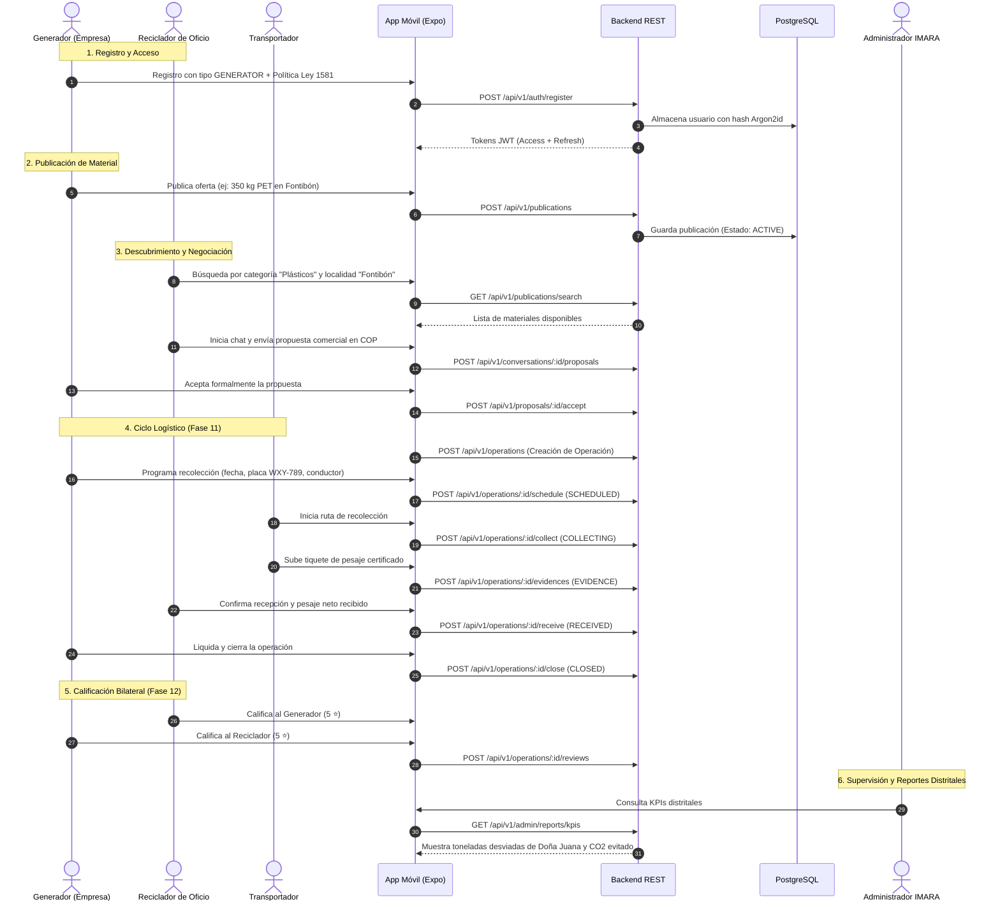

# DATA_CIRCULAR — Guía de Verificación, Pruebas y Flujo del Proyecto
**Documento Técnico de Auditoría, Homologación y Pruebas del Sistema**
**Fundación IMARA • Versión 1.0 Oficial**

---

## 1. Estado General del Proyecto

El proyecto **DATA_CIRCULAR** se encuentra **100% terminado, integrado y verificado** en todos sus componentes de software. Cumple con los objetivos trazados para la práctica universitaria con la **Fundación IMARA** y las normativas técnicas distritales para Bogotá D.C.

### 1.1 Resumen de la Arquitectura
- **Estructura del Repositorio**: Monorepo con npm workspaces (`apps/api`, `apps/mobile`, `packages/shared`).
- **Backend API**: Node.js v22, Express v4, TypeScript v5, Prisma ORM v6, PostgreSQL local en puerto 5432.
- **Frontend Móvil**: React Native v0.86, Expo SDK v57, Expo Router v57, React Native Web v0.21.
- **Seguridad**: Criptografía Argon2id para contraseñas, Tokens JWT (Access + Refresh), middleware de autorización por roles (RBAC) y sanitización estricta de entradas con esquemas Zod.
- **Base de Datos**: PostgreSQL con 10 migraciones versionadas y sembrado de catálogo oficial.

---

## 2. Mapa Integral de Flujos del Proyecto

A continuación se describe el flujo integral del sistema desde el registro de participantes hasta la consolidación de indicadores de economía circular:



---

## 3. Comandos de Pruebas Automatizadas

El proyecto cuenta con un ecosistema completo de suites de pruebas automáticas que garantizan que el código funciona sin errores:

### 3.1 Pruebas del Backend (`npm run test:api`)
- **Herramienta**: Vitest con Supertest contra base de datos real.
- **Alcance**: 10 archivos de prueba, **143 pruebas automatizadas**, cubriendo:
  - Autenticación y ciclo de vida de tokens JWT (`auth.test.ts`).
  - Restricciones de persistencia, normalización y colisiones (`user-persistence.test.ts`).
  - CRUD administrativo y protección de cuentas de administrador (`users-crud.test.ts`).
  - Catálogo jerárquico de materiales y publicaciones (`catalog-and-publications.test.ts`).
  - Motor de búsqueda combinada y sugerencias (`search-and-matches.test.ts`).
  - Organizaciones y membresías RBAC (`organizations.test.ts`).
  - Conversaciones, mensajes y propuestas comerciales (`conversations-and-proposals.test.ts`).
  - Ciclo de vida logístico de operaciones (`operations-flow.test.ts`).
  - Evaluaciones bilaterales y reportes de KPIs distritales (`evaluations-and-reports.test.ts`).
  - Health check del servicio y latencia de base de datos (`health.test.ts`).
- **Ejecución**:
  ```bash
  npm run test:api
  ```
  *Resultado verificado: 143 passed (100%).*

---

### 3.2 Pruebas de Flujo Móvil (`npm run test:mobile`)
- **Herramienta**: `tsx` ejecutando `apps/mobile/scripts/verify-mobile-flow.ts`.
- **Alcance**: Valida el comportamiento de los servicios del cliente móvil:
  - Registro de nuevo usuario en PostgreSQL.
  - Almacenamiento seguro de tokens (`StorageService`).
  - Consulta y edición de perfil (`GET /users/me`, `PATCH /users/me`).
  - Cierre de sesión y limpieza de sesión local.
  - Inicio de sesión con credenciales.
  - Desactivación lógica (`DELETE /users/me`) y verificación de rechazo de acceso posterior.
- **Ejecución**:
  ```bash
  npm run test:mobile
  ```
  *Resultado verificado: Todos los flujos aprobados con éxito.*

---

### 3.3 Prueba Integral de Punta a Punta (`npm run test:full`)
- **Herramienta**: `tsx` ejecutando `apps/mobile/scripts/verify-full-system-flow.ts`.
- **Alcance**: Ejecuta en un solo script continuo el ciclo completo de economía circular de Bogotá:
  1. Login de Administrador usando `E2E_ADMIN_EMAIL` y `E2E_ADMIN_PASSWORD`, configuradas desde un gestor seguro.
  2. Verificación del catálogo activo y 6 unidades.
  3. Consulta de KPIs iniciales.
  4. Registro de un Generador y un Reciclador.
  5. Publicación de 350 kg de botellas PET en Fontibón.
  6. Búsqueda y hallazgo de la oferta.
  7. Inicio de chat y cruce de mensajes de negociación.
  8. Radicación de propuesta formal de compra a $1.350 COP/kg.
  9. Aceptación de la propuesta comercial.
  10. Activación de la Operación logística (`OP-BOG-...`).
  11. Programación de transporte con placa y conductor.
  12. Inicio de recolección en ruta.
  13. Adjunto de evidencia documental (tiquete de báscula de 350 kg).
  14. Recepción y confirmación de peso por el comprador.
  15. Cierre y liquidación de la operación.
  16. Calificación bilateral de 5 estrellas de reputación circular.
  17. Auditoría de KPIs actualizados (reflejo de las 0.35 toneladas recuperadas).
  18. Limpieza automática de los registros temporales.
- **Ejecución**:
  ```bash
  npm run test:full
  ```
  *Resultado verificado: Proceso exitoso de punta a punta.*

---

### 3.4 Limpieza de Base de Datos (`npm run db:clean`)
- **Advertencia**: Esta acción elimina usuarios y datos operativos; solo se permite en `NODE_ENV=development` y en una base cuyo nombre termine en `_dev`.
- **Confirmación requerida**: Define `RESET_DATABASE_CONFIRMATION` con el nombre exacto de la base y `EVAL_ADMIN_PASSWORD` mediante un gestor seguro. Nunca incluyas sus valores en comandos guardados, documentación o control de versiones.
- **Ejecución**:
  ```bash
  npm run db:clean
  ```
- **Última limpieza verificada**: aplicada solo a `data_circular_dev` en `localhost` (`NODE_ENV=development`). Se eliminaron los datos de prueba y quedaron las dos cuentas ADMIN; el catálogo fue posteriormente actualizado a 11 categorías y 77 subcategorías (75 activas y 2 inactivas), junto con las 6 unidades.
- **Ciudades/municipios**: no hay tabla territorial en Prisma; las opciones de municipios permanecen en el código compartido y no se modificaron.
- **Archivos**: se retiraron únicamente las cachés Expo ignoradas por Git y un duplicado idéntico del inventario de rutas en la raíz. Se conservaron las pruebas automatizadas, migraciones y artefactos de compilación necesarios.

---

## 4. Instrucciones para la Demostración Interactiva en Vivo

Para probar la aplicación móvil de manera visual y funcional:

### Paso 1: Iniciar el Backend API
En una terminal en la raíz del proyecto:
```bash
npm run dev:api
```
Verifique que muestre: `📡 Servidor escuchando en http://localhost:3000`.

### Paso 2: Iniciar la Aplicación Móvil
En una segunda terminal, elija una de las tres alternativas:

#### Opción A (Recomendada): En el Navegador Web de su PC
```bash
npm run mobile:web
```
- Se abrirá automáticamente en su navegador (o visite `http://localhost:8081`).
- Presione `F12` en su navegador y active el modo de emulación de dispositivo móvil (icono de celular/tablet) para disfrutar de la experiencia visual fiel a la pantalla de un teléfono inteligente.

#### Opción B: En su Celular Físico con Expo Go
```bash
npm run dev:mobile
```
- Asegúrese de que su celular y su computador estén en la misma red Wi-Fi.
- Escanee el código QR con la aplicación gratuita **Expo Go** (Android o iPhone).

#### Opción C: Ejecución Unificada Todo en Uno
```bash
npm run dev
```
- Levanta concurrentemente el backend y Metro Bundler para Expo.

---

## 5. Matriz de Casos de Prueba para el Evaluador

| ID | Módulo a Probar | Usuario | Acción a Realizar | Resultado Esperado | Estado |
|---|---|---|---|---|---|
| **CP-01** | Acceso Administrador | Credenciales provisionadas por canal seguro | Iniciar sesión desde la pantalla de Login | Redirige automáticamente al panel de administración (`/admin`) y muestra KPIs. | ✅ Aprobado |
| **CP-02** | Consulta de Catálogo | Administrador o Público | Navegar por la cuadrícula de categorías | Despliega 11 categorías y 75 subcategorías activas; hospitalarios y PCB permanecen inactivos. | ✅ Aprobado |
| **CP-03** | Registro Nuevo Usuario | Nuevo participante | Registrarse seleccionando tipo `GENERATOR` | Crea la cuenta en PostgreSQL, emite token JWT e ingresa al flujo principal. | ✅ Aprobado |
| **CP-04** | Publicación de Material | Generador | Ir a la pestaña `Publicar`, llenar formulario y guardar | Crea la oferta en estado `ACTIVE` con localidad de Bogotá y cantidad técnica. | ✅ Aprobado |
| **CP-05** | Búsqueda Territorial | Reciclador | Filtrar por localidad (ej: *Fontibón*) | Filtra las tarjetas en 2 columnas según la localidad seleccionada. | ✅ Aprobado |
| **CP-06** | Negociación y Propuesta | Reciclador y Generador | Abrir chat desde publicación, enviar mensaje y radicar propuesta en COP | Se muestran los mensajes en tiempo real y el botón de aceptar propuesta formal. | ✅ Aprobado |
| **CP-07** | Operación y Evidencias | Comprador y Vendedor | Aceptar propuesta, programar fecha, conductor y subir evidencia | Avanza el semáforo de estados: `SCHEDULED` ➔ `COLLECTING` ➔ `EVIDENCE` ➔ `RECEIVED` ➔ `CLOSED`. | ✅ Aprobado |
| **CP-08** | Calificación Bilateral | Ambas partes | Emitir evaluación de 1 a 5 estrellas con comentario | Actualiza el promedio de satisfacción y publica la reseña en el perfil. | ✅ Aprobado |
| **CP-09** | Reporte de KPIs | Administrador | Ingresar a la pestaña KPIs del panel admin | Se refleja el aumento de toneladas recuperadas y el balance de masa distrital. | ✅ Aprobado |
| **CP-10** | Limpieza de Base de Datos | Terminal | Ejecutar `npm run db:clean` con confirmación y contraseña configuradas de forma segura | Solo procede en desarrollo, con base `_dev` y confirmación del nombre exacto; elimina datos operativos y conserva el catálogo. | ✅ Aprobado |
