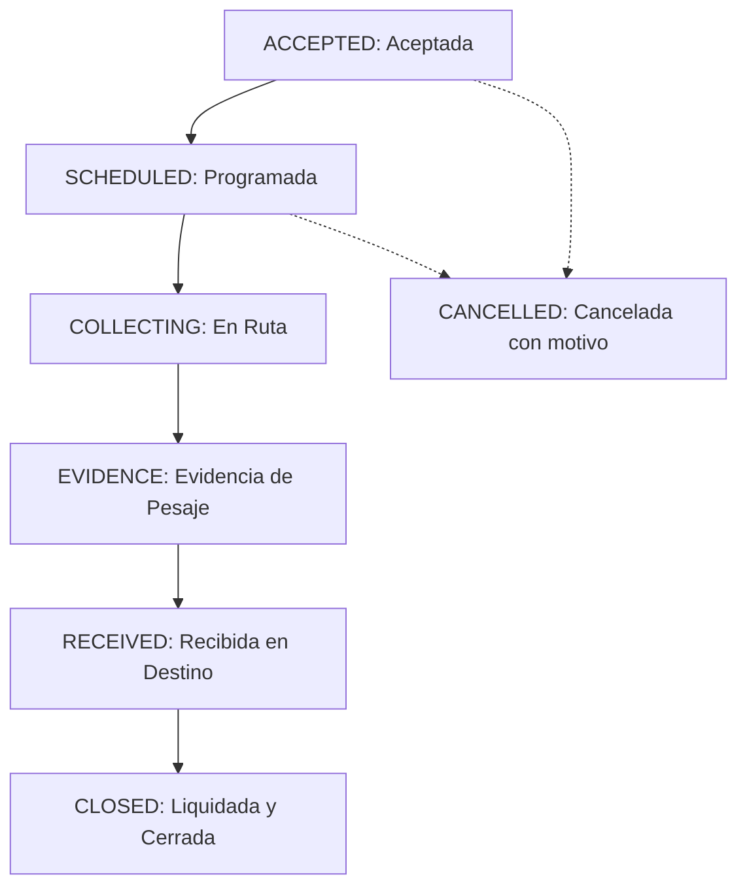

# DATA_CIRCULAR — Manual de Usuario Final
**Plataforma Colaborativa de Economía Circular para Bogotá D.C.**
**Fundación IMARA • Versión 1.0 Oficial**

---

## 1. Introducción y Propósito del Sistema

**DATA_CIRCULAR** es la plataforma tecnológica distrital diseñada y desarrollada en colaboración con la **Fundación IMARA** para conectar de manera transparente, trazable y eficiente a los cuatro actores fundamentales de la economía circular y la gestión de materiales aprovechables en Bogotá D.C.:

1. **Generadores (GENERATOR)**: Industrias, comercios, instituciones y conjuntos residenciales que producen residuos aprovechables y desean ofertarlos a recicladores o transformadores autorizados.
2. **Recicladores de Oficio y Asociaciones (RECYCLER)**: Organizaciones y recuperadores ambientales que recolectan, clasifican y comercializan materiales reciclables en las 20 localidades de la ciudad.
3. **Transportadores Especializados (TRANSPORTER)**: Prestadores de servicios logísticos autorizados para el traslado seguro y normativo de materiales y cargas aprovechables.
4. **Transformadores e Industrias de Reincorporación (TRANSFORMER)**: Empresas e industrias que compran materias primas secundarias para reincorporarlas en ciclos productivos circulares.

El aplicativo está construido con tecnologías modernas para dispositivos móviles (**React Native / Expo SDK**) y cuenta con un backend robusto (**Node.js, Express, Prisma ORM y PostgreSQL**) que garantiza la inmutabilidad de los datos, la trazabilidad de los pesajes y la seguridad jurídica bajo la legislación colombiana (Ley 1581 de 2012 de Protección de Datos Personales).

---

## 2. Tipos de Participantes y Perfiles

| Tipo de Usuario | Ícono | Rol en la Plataforma | Capacidades Principales |
|---|---|---|---|
| **Generador** | 🏭 | Productor de material | Publicar ofertas de residuos limpios, negociar condiciones, acordar recolecciones y evaluar el servicio. |
| **Reciclador** | ♻️ | Recuperador de oficio | Explorar ofertas por localidad, acordar precios justos en COP, enviar propuestas de compra y registrar pesajes. |
| **Transportador** | 🚛 | Operador logístico | Asignar vehículos y conductores, coordinar rutas de retiro y documentar el traslado. |
| **Transformador** | ⚙️ | Industria compradora | Adquirir grandes volúmenes de material clasificado, certificar recepción en báscula y liquidar transacciones. |

---

## 3. Guía Paso a Paso de las Pantallas de la Aplicación Móvil

### 3.1 Pantalla 1: Bienvenida e Introducción (Onboarding)
- **Acceso**: Al abrir la aplicación por primera vez o tras cerrar sesión.
- **Elementos Visuales**:
  - Cabecera curva institucional en verde bosque (`#1F4D36`) con el logotipo de **DATA_CIRCULAR** y el subtítulo *"Fundación IMARA • Circular Economy"*.
  - Mensaje inspirador centrado en el impacto ambiental y social para Bogotá D.C.
  - **Tres Sellos Circulares de Sostenibilidad**:
    1. *Sostenibilidad Certificada*: Asegura que los procesos cumplen las normas ambientales distritales.
    2. *Reciclaje Circular*: Promueve la valorización efectiva y reincorporación de materias primas.
    3. *Impacto Positivo*: Fomenta el reconocimiento y pago digno al reciclador de oficio.
  - Botón principal verde esmeralda: **"Iniciar Sesión"**.
  - Enlace secundario: **"Crear Cuenta Nueva"**.

---

### 3.2 Pantalla 2: Registro de Usuario
- **Ruta**: `app/(auth)/register.tsx`
- **Campos Requeridos**:
  1. **Nombre Completo o Razón Social**: Nombre de la persona natural o representante de la empresa (mínimo 3 caracteres).
  2. **Correo Electrónico**: Dirección institucional o personal (ej: `usuario@empresa.com.co`). Se normaliza automáticamente a minúsculas.
  3. **Teléfono Celular**: Número de contacto en Colombia (ej: `+57 310 123 4567`).
  4. **Tipo de Participante**: Selector obligatorio de rol circular:
     - `Generador` (Empresa, comercio o institución)
     - `Reciclador` (Asociación u operador de acopio)
     - `Transportador` (Fletes y logística de carga)
     - `Transformador` (Industria final)
  5. **Contraseña Segura**: Mínimo 8 caracteres, combinando mayúsculas, minúsculas, números y caracteres especiales. El sistema la protege con algoritmo criptográfico **Argon2id**.
  6. **Confirmación de Contraseña**: Verificación exacta de coincidencia.
  7. **Aceptación de Política de Tratamiento de Datos Personales**: Casilla obligatoria en cumplimiento de la Ley 1581 de 2012 y Decreto 1377 de 2013 de Colombia. Enlace directo a la política distrital vigente.
- **Acción**: Tocar el botón **"Completar Registro"**. Al completarse con éxito, el sistema emite automáticamente un token seguro JWT y redirige a la pantalla principal.

---

### 3.3 Pantalla 3: Inicio de Sesión (Login)
- **Ruta**: `app/(auth)/login.tsx`
- **Campos Requeridos**:
  1. **Correo Electrónico**: Correo registrado previamente.
  2. **Contraseña**: Contraseña asignada. Incluye botón de alternar visibilidad (👁️).
- **Acción**: Tocar el botón **"Ingresar"**.
- **Comportamiento Inteligente de Redirección**:
  - Si el usuario tiene rol **ADMIN**, la aplicación abre inmediatamente el **Panel de Administración Distrital** (`/(app)/admin`).
  - Si el usuario tiene rol **USER** y tipo **GENERATOR**, se le sitúa con acceso directo para publicar materiales.
  - Para los demás participantes, se abre el **Mercado Circular de Publicaciones** (`/(app)`).

---

### 3.4 Pantalla 4: Mercado Circular y Exploración de Materiales
- **Ruta**: `app/(app)/index.tsx`
- **Componentes**:
  - **Barra de Búsqueda Superior**: Permite escribir términos libres (ej: *"PET cristal"*, *"chatarra"*, *"madera"*, *"Fontibón"*).
  - **Catálogo de materiales**: 11 categorías principales con 75 subcategorías activas. Incluye plásticos, metales, madera, muebles para reutilizar, textiles y calzado, orgánicos, electrónicos y posconsumo, residuos de construcción, papel y cartón, vidrio y residuos peligrosos. Residuos hospitalarios y equipos con PCB se mantienen inactivos hasta decisión jurídica.
  - **Botón de Filtros Avanzados (⚙️ Filtros)**: Abre una ventana modal para filtrar por:
    - Localidad distrital específica (Usaquén, Chapinero, Santa Fe, San Cristóbal, Usme, Tunjuelito, Bosa, Kennedy, Fontibón, Engativá, Suba, Barrios Unidos, Teusaquillo, Los Mártires, Antonio Nariño, Puente Aranda, La Candelaria, Rafael Uribe Uribe, Ciudad Bolívar, Sumapaz).
    - Estado de urgencia (`⚡ Urgente`).
    - Ordenamiento por fecha de publicación.
  - **Cuadrícula de Tarjetas de Material (2 Columnas)**:
    - Etiqueta de tipo (`OFERTA`).
    - Foto del material o miniatura temática representativa.
    - Cantidad con unidad técnica (ej: `500 kg`, `2.5 ton`, `80 und`).
    - Ubicación con pin territorial distrital (ej: `📍 Fontibón`).
    - Botón **"Ver detalle"**: Abre la ficha completa de la publicación.

---

### 3.5 Pantalla 5: Publicación de Material Aprovechable
- **Ruta**: `app/(app)/publish.tsx`
- **Disponible para**: Usuarios con perfil **Generador**.
- **Paso a Paso para Publicar una Oferta**:
  1. **Seleccionar Categoría Principal**: Elegir una de las 11 categorías vigentes.
  2. **Seleccionar Subcategoría Específica**: El sistema exige seleccionar el tipo exacto (ej: dentro de Plásticos, elegir *"PET (botellas transparentes, de color...)"*). Esto previene publicaciones ambiguas.
  3. **Cantidad y Unidad de Medida**: Digitar el valor numérico (ej: `350`) y seleccionar la unidad técnica oficial (`Kilogramo`, `Tonelada`, `Unidad`, `Litro`, `Metro cúbico`, `Bulto/Saco`).
  4. **Descripción Detallada**: Estado del material, tipo de embalaje (pacas, suelto, big bags), frecuencia de generación.
  5. **Localidad y Dirección de Retiro**:
     - Localidad de Bogotá (ej: *Fontibón*).
     - Dirección exacta de la bodega o punto de retiro (ej: *Calle 17 # 92-30 Bodega 4*).
  6. **Condiciones del Residuo**: Indicar si está limpio, seco, compactado o clasificado.
  7. **Interruptor de Urgencia**: Activar si el material debe ser retirado en menos de 48 horas.
  8. **Botón de Publicación**: Tocar **"Publicar Oferta de Material"**. La publicación entra inmediatamente en estado `ACTIVE` y se hace visible para todos los recicladores de la ciudad.

---

### 3.6 Pantalla 6: Ficha Detallada de Publicación
- **Ruta**: `app/(app)/publication/[id].tsx`
- **Información Visualizada**:
  - Fotografía ampliada del material.
  - Estado de la publicación (`ACTIVA`, `PAUSADA`, `CERRADA`).
  - Nombre del ofertante y organización vinculada.
  - Volumen exacto y unidad técnica.
  - Localidad distrital y dirección referencial.
  - Módulo de **Sugerencias de Coincidencias**: Muestra automáticamente recicladores y transformadores cercanos que demandan este material.
  - **Botón "Iniciar Conversación"**: Abre un canal de mensajería directo con el dueño del material.

---

### 3.7 Pantalla 7: Canal de Negociación, Chat y Propuestas Comerciales
- **Ruta**: `app/(app)/chat.tsx`
- **Estructura en 3 Secciones Principales**:

#### A. Sección 💬 Mensajes:
- Muestra la lista de conversaciones activas con foto de perfil, nombre de la contraparte, material negociado y badge con el conteo de mensajes no leídos.
- Al tocar una conversación:
  - Hilo de chat en tiempo real con mensajes inmutables protegidos en base de datos.
  - Mensajes de sistema destacados en cajas informativas cuando ocurren eventos clave (ej: *"Propuesta formal radicada"*, *"Propuesta aceptada"*).
  - Campo de texto inferior para enviar mensajes instantáneos.
  - Botón **"Radicar Propuesta"**: Abre el modal de formalización económica.

#### B. Sección 📝 Propuestas Comerciales:
- Permite formalizar acuerdos comerciales transparentes antes de mover el residuo:
  - **Cantidad Acordada**: Volumen a transaccionar.
  - **Precio Unitario y Total en COP**: En pesos colombianos (ej: `$ 1.350 COP/kg` para un total de `$ 472.500 COP`).
  - **Términos de Pago y Flete**: Especifica si el transporte corre por cuenta del comprador o vendedor, y método de pago (contra entrega, transferencia bancaria, etc.).
- **Acciones Disponibles**:
  - El receptor puede pulsar **"✓ Aceptar"** o **"✕ Rechazar"**.
  - Al pulsar **"✓ Aceptar"**, el sistema genera automáticamente una **Operación Logística** oficial vinculada a la propuesta.

#### C. Sección 🚛 Operaciones y Trazabilidad:
- Permite hacer seguimiento paso a paso a los retiros físicos acordados.

---

### 3.8 Pantalla 8: Seguimiento Logístico de la Operación (Ciclo de Vida)
Una vez aceptada una propuesta, la operación avanza a través de 6 fases secuenciales e inviolables:

1. **ACCEPTED (Aceptada)**: Se genera el código único distrital de trazabilidad (ej: `OP-BOG-2026-0001-709`).
2. **SCHEDULED (Programada)**:
   - Se fija la fecha exacta y franja horaria de recolección (ej: *08:00 AM - 11:00 AM*).
   - Se registra el nombre del conductor y la placa del vehículo de carga (ej: *Placa: WXY-789*).
   - Se confirma la dirección de cargue y descargue.
3. **COLLECTING (En Ruta / Recolección)**:
   - El transportador o reciclador confirma que el camión ha iniciado el recorrido hacia el punto de retiro.
4. **EVIDENCE (Carga de Evidencias)**:
   - Se adjunta fotografía del material cargado o **Tiquete de Báscula Certificada**.
   - Se digita el peso bruto o tara verificado en kilogramos.
5. **RECEIVED (Recibida en Destino)**:
   - El comprador (reciclador o transformador) confirma la llegada a su centro de acopio o planta.
   - Registra el peso neto definitivo recibido (ej: `350 kg`) y notas de calidad.
6. **CLOSED (Cerrada y Liquidada)**:
   - Las partes dan por concluida la transacción económica y logística.
   - El volumen se suma oficialmente a los indicadores distritales de economía circular de la Fundación IMARA.

---

### 3.9 Pantalla 9: Calificación Bilateral y Reputación Circular
- **Momento de Activación**: Inmediatamente después de que una operación llega al estado `CLOSED`.
- **Campos de Evaluación (Escala 1 a 5 Estrellas ⭐)**:
  1. **Puntaje Global**: Satisfacción general de la experiencia comercial.
  2. **Puntualidad**: Cumplimiento del horario y fecha pactada para el retiro o entrega.
  3. **Calidad del Material**: Concordancia del residuo entregado frente a la descripción (limpieza, humedad, clasificación).
  4. **Cumplimiento de Acuerdos**: Respeto al precio en COP acordado y condiciones de pago.
  5. **Comentario Público**: Reseña descriptiva que se publica en el perfil de la contraparte para orientar a otros miembros de la red.

---

### 3.10 Pantalla 10: Perfil de Usuario y Organizaciones
- **Ruta**: `app/(app)/profile.tsx`
- **Funcionalidades**:
  - **Tarjeta de Identidad**: Nombre completo, correo, teléfono y badge del tipo de usuario (`GENERADOR`, `RECICLADOR`, etc.).
  - **Reputación Acumulada**: Promedio de estrellas obtenidas en operaciones cerradas y número total de transacciones completadas.
  - **Gestión de Organización**: Permite asociar o crear una personería jurídica (Empresa comercial, Asociación de recicladores, Fundación o Cooperativa), con número de NIT, dirección y localidad.
  - **Edición de Perfil (`edit-profile.tsx`)**: Modificación segura de nombre de contacto y teléfono.
  - **Cierre de Sesión**: Invalida el token en el dispositivo y limpia el almacenamiento seguro (`SecureStore`).
  - **Desactivación Lógica de Cuenta (Soft-Delete)**: Opción para suspender la cuenta voluntariamente sin borrar el histórico legal de operaciones en las que haya participado.

---

## 4. Preguntas Frecuentes de los Usuarios (FAQ)

### ¿Quién puede publicar ofertas de materiales?
Únicamente los usuarios registrados como **Generadores**. Los recicladores y transformadores son los encargados de buscar dichas ofertas y emitir propuestas comerciales de compra.

### ¿Por qué no puedo solicitar transporte inmediatamente al crear la publicación?
Por normativa del modelo circular distrital, el flete y transporte solo se solicitan una vez existe una contraparte interesada y una propuesta aceptada. Esto evita movilizaciones en vacío y reduce la huella de carbono en Bogotá.

### ¿Qué pasa si el peso recibido es diferente al ofertado?
En la fase de recepción (`RECEIVED`), el comprador introduce el peso neto exacto verificado en su báscula. Ese valor es el que liquida la operación final y alimenta los indicadores oficiales.

### ¿Cómo protege la plataforma mis datos personales?
Todos los datos se tratan con estricto apego a la Ley 1581 de 2012 de Habeas Data en Colombia. Las contraseñas están protegidas con el estándar bancario Argon2id y las sesiones expiran mediante tokens criptográficos JWT.
